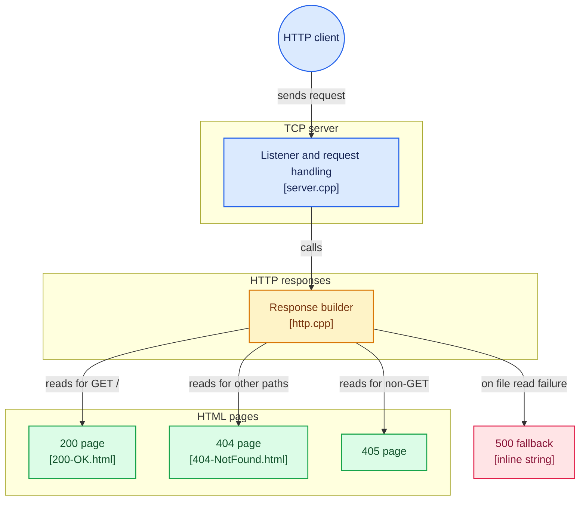

# HTTP Server from Scratch

A minimal HTTP server written in C++, built directly on top of the POSIX
socket API. No networking frameworks, no third-party HTTP libraries — the
TCP handshake, request parsing, and response construction are all
implemented by hand.

## Objectives

This project was built to understand what actually happens underneath an
HTTP server, rather than learning it through a framework that hides the
transport layer. The goal was to implement the full path from a raw TCP
connection to a correctly formatted HTTP response, using only the
operating system's own socket interface.

## Constraints

- **Language:** C++
- **Built directly on the OS socket API** (`sys/socket.h`, `netdb.h`), the
  standard interface to the transport layer
- **No third-party networking or HTTP frameworks or libraries**

## Features

What the server currently does:

- Resolves its own listening address via `getaddrinfo()`, independent of
  IPv4/IPv6 (`AF_UNSPEC`)
- Accepts incoming TCP connections in a loop, handling one client at a
  time
- Parses the HTTP request line (method, path, version) from the raw bytes
  received
- Responds correctly to `GET` requests for `/`, serving an HTML file from
  disk
- Returns `404 Not Found` for any other path
- Returns `405 Method Not Allowed` for any non-`GET` request
- Falls back to `500 Internal Server Error` if an expected response file
  fails to open
- Builds complete, correctly formatted HTTP responses (status line,
  `Content-Type`, `Content-Length`, body) rather than hardcoded text

## Technologies used

- C++
- POSIX sockets: `socket()`, `bind()`, `listen()`, `accept()`, `recv()`,
  `send()`
- `getaddrinfo()` / `freeaddrinfo()` for address resolution
- `std::ifstream` / `std::stringstream` for reading response files from
  disk
- No external dependencies

## Architecture

The socket API sits between the application layer and the transport
layer, it isn't itself part of either. This project calls directly into
that interface rather than going through any higher-level abstraction.

Request lifecycle:

```
getaddrinfo()  →  resolve this machine's own listening address
socket()       →  create a socket using the resolved family/type/protocol
bind()         →  attach the socket to the resolved address and port
listen()       →  mark the socket as ready to accept connections
accept()       →  (in a loop) accept one client connection at a time,
                   returning a new socket dedicated to that client
recv()         →  read the raw request bytes from the client
buildResponse()→  parse the request line and construct a full HTTP
                   response (http.cpp)
send()         →  write the response back to the client
close()        →  release the per-client socket
```

The listening socket persists across the entire lifetime of the program;
`accept()` returns a separate socket for each client, which is read,
responded to, and closed before the loop returns to `accept()` for the
next connection.



### Project structure

```
src/
├── server.cpp   — socket setup, accept loop, request/response I/O
├── http.h       — declares buildResponse()
└── http.cpp     — request parsing and response construction
public/
├── 200-OK.html
├── 404-NotFound.html
└── 405-MethodNotAllowed.html
```

`server.cpp` owns the network I/O. `http.cpp` owns the decision of what to
respond with, given a method and a path; it has no knowledge of sockets at
all, it reads a file and returns a `std::string`.

## How it works

1. `getaddrinfo()` is called with `AF_UNSPEC`, `SOCK_STREAM`, and
   `AI_PASSIVE`, letting the OS resolve a listening address without the
   program assuming IPv4 or IPv6 in advance.
2. `socket()`, `bind()`, and `listen()` use the values resolved by
   `getaddrinfo()` directly (`servaddrinfo->ai_family`, and so on) rather
   than hardcoded constants, so the program doesn't contradict its own
   `AF_UNSPEC` request.
3. The server enters a `while(true)` loop. Each iteration calls `accept()`,
   which blocks until a client connects, then returns a new socket
   specific to that client. The original listening socket is unaffected
   and remains ready for the next connection.
4. `recv()` reads the raw request into a buffer, which is wrapped in a
   `std::string` so `.find()` and `.substr()` can be used to isolate the
   request line and split it into method, path, and version.
5. `buildResponse(method, path)` decides what to send back: it opens the
   matching file in `public/`, reads its contents, and assembles a
   complete HTTP response string (status line, headers, blank line, body).
   If the file can't be opened, it returns a `500` response instead.
6. `server.cpp` sends whatever `buildResponse()` returns and closes the
   per-client socket.

## Implementation decisions

**Reading resolved values instead of hardcoding them.** Early versions of
this project hardcoded `PF_INET` in the call to `socket()`. This silently
contradicted the `AF_UNSPEC` hint given to `getaddrinfo()`, since
hardcoding IPv4 would force that choice regardless of what the OS actually
resolved. The fix was to read `ai_family`, `ai_socktype`, and
`ai_protocol` directly from the result of `getaddrinfo()`, letting that
one resolution step be the single source of truth for every function that
follows it.

**Separating response-building from socket I/O.** `buildResponse()` takes
only `method` and `path`, nothing else. Everything else it needs, which
file to open, the status line, the headers, is either hardcoded inside the
function or computed from the file it reads. This keeps `http.cpp`
testable independent of any actual network connection, and keeps
`server.cpp` focused only on moving bytes in and out.

## Challenges and lessons learned

**Understanding `accept()`'s parameters.** The hardest part of this
project was understanding why `accept()`'s second argument needed to be
written as `(struct sockaddr *) &clientaddr`. The confusion had two
separate layers that needed to be pulled apart:

- `&clientaddr` produces a pointer whose type depends on what `clientaddr`
  already is. Since `clientaddr` is declared as a plain
  `struct sockaddr_storage` (not a pointer), `&clientaddr` naturally
  produces a single pointer: `struct sockaddr_storage *`.
- `accept()`'s signature requires a `struct sockaddr *` specifically. The
  cast, `(struct sockaddr *)`, doesn't add or remove a level of
  indirection, it relabels the type of the pointer `&` already produced,
  so the compiler accepts it where a generic `sockaddr *` is expected.

This was easy to confuse with the earlier, differently-shaped case of
`getaddrinfo(..., &servaddrinfo)`, where `servaddrinfo` is itself already
a pointer, so `&servaddrinfo` produces a pointer-to-pointer. The general
rule that resolved the confusion: `&` always adds exactly one level of
"pointer-ness" on top of whatever the variable already is, a plain struct
yields one pointer, a variable that's already a pointer yields a pointer
to a pointer.

**`getaddrinfo()` returns a linked list, but only one result is used.**
`getaddrinfo()` can resolve and chain together multiple `addrinfo`
results. The current implementation only ever uses the first one
(`servaddrinfo` itself), it never walks `ai_next`. This was confirmed, not
assumed, by checking `servaddrinfo->ai_next` at runtime: on this machine,
`getaddrinfo()` does return more than one result, meaning a failure on the
first entry (for example, if IPv6 wasn't available) would currently crash
the server rather than falling back to a working alternative.

## Installation and usage

Requires a C++ compiler (`g++`) on a POSIX-compliant system (Linux,
macOS, or WSL on Windows).

```bash
cd src
g++ -Wall -Wextra server.cpp http.cpp -o server
./server
```

**The server must be run from inside `src/`.** Response files are
currently located using relative paths (`"../public/200-OK.html"`),
resolved relative to the process's working directory, not the location
of the source files. Running the binary from any other directory will
cause every response to fall back to `500 Internal Server Error`.

Once running, the server listens on port `8080`. Test with:

```bash
curl localhost:8080/
curl localhost:8080/anything
curl -X POST localhost:8080/
```

## Known limitations

- Only the first address returned by `getaddrinfo()` is used; the
  linked list is never traversed, so there's no fallback if the first
  result fails to bind.
- One client is handled at a time; `accept()` blocks the loop, so a
  second client cannot connect while the current one is being served.
- `recv()` and `send()` are each called once per request, with no
  handling for partial reads or partial writes.
- No validation on malformed request lines. If a request doesn't contain
  at least two spaces on its first line, the current parsing logic has no
  guard against that and its behavior is untested.
- `version` is parsed out of the request line but is not validated or
  used anywhere.
- Only the request line is parsed; headers are received but not
  processed.
- Response file paths are relative to the working directory the server is
  launched from, not to the location of the source files.

## Future improvements

- Loop through the full `addrinfo` list on startup, attempting
  `socket()`/`bind()` on each entry until one succeeds
- Handle multiple clients concurrently (`poll()`)
- Handle partial `send()`/`recv()` correctly
- Return `400 Bad Request` for malformed request lines instead of leaving
  the behavior undefined
- Resolve response file paths independently of the process's working
  directory
